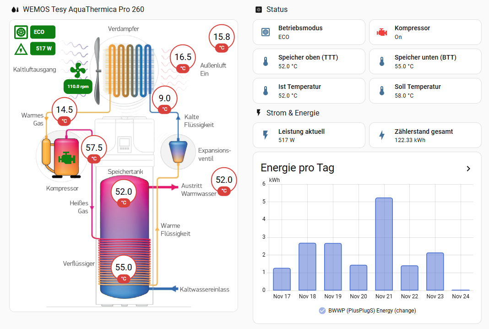

# TESY Aquathermica Pro (BWWP) → Home Assistant

Read-only integration of the **TESY Aquathermica Pro** heat-pump water heater (BWWP, controller board *PC1006*) into **Home Assistant** by passively listening to its internal RS485 bus. No cloud, no modification of the unit, nothing is ever sent to the heat pump.

You get tank temperatures, ambient/evaporator/compressor temperatures, operating mode, setpoint, compressor / electric-heater state, fan speed, EEV steps, superheat, compressor runtime, device clock and – optionally – ~100 further parameter registers (defrost, disinfection, fan stages, …).

> **Status**
> * Developed and used on a **TESY Aquathermica Pro 260 without solar heat exchanger (HPWH 4.11 FS 260 U01)**. The ESPHome device probably also works with other TESY BWWP models that use the same controller/protocol, but this is **untested**.
> * The ESPHome decoder runs on the author's device, including compressor state and fan speed while the compressor is running. It is also validated against recorded bus captures (`tests/`) and checked by CI.
> * The **extra entities** (`tesy-bwwp-extra.yaml`) are partly **not verified** – the register meanings are hypotheses, see [Known limitations](#known-limitations).
> * Motivation: read the data into Home Assistant (energy/consumption values and a long-term history) and understand how the heat pump behaves. That goal is reached, so the project is not actively developed further. Contributions are welcome, but maintenance is best-effort.
> * This project is not affiliated with or endorsed by TESY. Use at your own risk.



## How it works

The unit's controller continuously sends its state as Modbus-RTU frames on an internal RS485 bus. A Wemos D1 mini with a TTL-to-RS485 module listens on connector `CN5`, an ESPHome custom decoder stores every register by its Modbus address (CRC checked), and template sensors expose the values to Home Assistant. A register that moves inside a frame (or a changed block size) does not break anything. The ESP never transmits.

```
 TESY PC1006 board ── CN5 (RS485 A/B) ── MAX13487 module ── Wemos D1 mini (ESPHome) ──► Home Assistant
```

> **Archive:** my first attempt was a Waveshare RS485-to-Ethernet gateway with Node-RED and MQTT discovery. It is kept in [`archive/node-red-waveshare/`](archive/node-red-waveshare/) for reference and is **no longer developed**.

## Quick start (ESPHome)

1. Build the hardware: [docs/hardware.md](docs/hardware.md) (4 wires to the module, 2 wires to the RS485 connector `CN5`).
2. Copy the files from [`esphome/`](esphome/) into your ESPHome config folder:
   `tesy-bwwp.yaml`, `tesy_decoder.h`, and `secrets.yaml` (from `secrets.yaml.example`).
3. Install. In the logs you should see no `CRC error`. In HA, the diagnostic sensor **RS485 valid frames** counts up by one every ~2.7 s, **RS485 CRC errors** stays at 0.
4. Optional: import the example dashboard from [`homeassistant/dashboard.yaml`](homeassistant/dashboard.yaml) ([docs/dashboard.md](docs/dashboard.md)).

> **The one setting that matters:** `stop_bits: 1` (9600 **8N1**). With 2 stop bits the ESP silently loses bytes and everything looks "shifted". Details in [docs/protocol.md](docs/protocol.md).

## Documentation

| | |
|---|---|
| [docs/hardware.md](docs/hardware.md) | Parts, wiring, `CN5` pinout, photos |
| [docs/protocol.md](docs/protocol.md) | What is on the bus, frame format, scaling, the stop-bit pitfall |
| [docs/registers.md](docs/registers.md) | Register table (109 entries) incl. manual defaults |
| [docs/dashboard.md](docs/dashboard.md) | Example dashboard, how to get the background picture |
| [docs/troubleshooting.md](docs/troubleshooting.md) | Symptoms → causes |
| [docs/tesy-statement.md](docs/tesy-statement.md) | What TESY says about third-party access |
| [CONTRIBUTING.md](CONTRIBUTING.md) | Contributions (best-effort maintenance) |

## Known limitations

* Read-only. Writing setpoints/modes is not supported and not planned.
* **The extra entities are only partly verified.** For many parameter registers the assignment to a parameter code is a hypothesis or based on a single observation. Unverified ones are marked `(?)` / `(unclear)` / `(undocumented)` in their names – but treat all extra entities as unverified unless you have checked them against your unit.
* The ESP8266 has little RAM: enable only the extra entities you need ([`tesy-bwwp-extra.yaml`](esphome/tesy-bwwp-extra.yaml)).
* Parameter names follow the TESY *Installation & Maintenance* manual where the manual lists them; the register↔parameter assignment is the author's own finding.

## AI-assisted, no warranty

The ESPHome decoder, the (archived) Node-RED flow, this documentation and the forum article were created with the help of AI (Claude). They may contain errors. Everything here is provided **as is, at your own risk, without any warranty** (see [LICENSE](LICENSE)). Check the values against your unit's display before relying on them.

## No official support from TESY

TESY told the author that the Aquathermica HPWH range offers no offline connection and no way to link the controller to third-party systems, and declined to share information about the controller's communication; a Wi-Fi model range is said to be in development. This project is therefore **unofficial**, based solely on observing the bus. See [docs/tesy-statement.md](docs/tesy-statement.md).

## Safety

The unit contains **mains voltage**. Only work on the low-voltage RS485 connector, with the unit powered down and unplugged while you open it, and only if you know what you are doing. Opening the unit may affect your warranty.

## Repository layout

```
esphome/        ESPHome YAML + C++ decoder (tesy_decoder.h)
archive/        first attempt: Waveshare gateway + Node-RED (not developed further)
homeassistant/  Example dashboard
docs/           Hardware, protocol, registers, troubleshooting, photos
tests/          Host tests with real captured frames (decoder + flow)
```

## Tests

```sh
tests/run.sh            # C++ decoder against captured frames (needs g++)
node tests/test_flow.js # archived Node-RED function against the same frames (needs Node.js)
```

## License

MIT – see [LICENSE](LICENSE). The TESY brochure pictures and manuals are © TESY and are **not** part of this repository.
