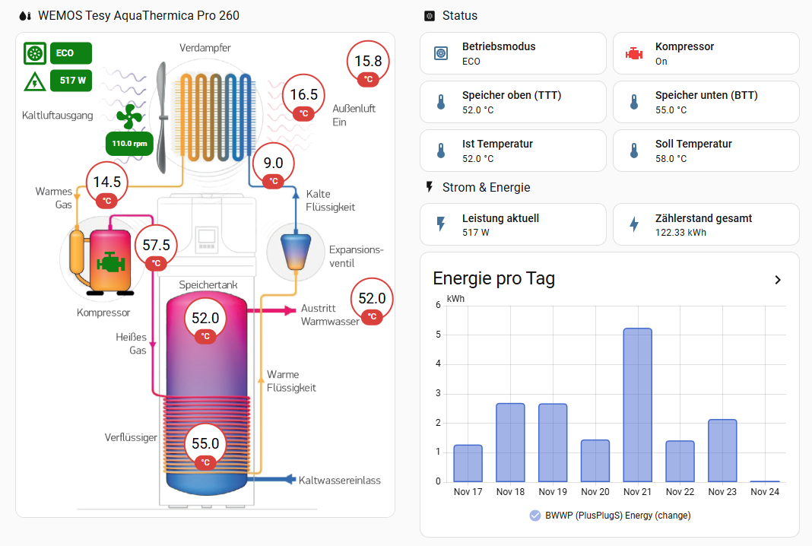

# Example dashboard

[`homeassistant/dashboard.yaml`](../homeassistant/dashboard.yaml) is a *sections* view with a picture-elements card (temperatures, compressor, fan and mode overlaid on a schematic of the heat pump) and a status column with tiles and an energy graph.

It only uses core Home Assistant cards.


*The author's dashboard (German labels, German brochure picture). The background picture is © TESY and shown here only to illustrate the layout; it is not licensed under this repository's MIT license.*

## 1. Get the background picture

The picture is **not** included here – it is © TESY. The author uses the schematic from the **AquaThermica Compact** brochure (it looks better than the one in the Aquathermica Pro brochure):

* AquaThermica Compact brochure (DE): <https://www.germany.tesy.com/_files/ugd/9e9435_bfe7f9bd268347ac97009d223e0841ea.pdf>
* AquaThermica Pro brochure (DE, alternative): <https://www.germany.tesy.com/_files/ugd/9e9435_f75ff4a079324d3ea968dd05a076ad74.pdf>

The image embedded in the PDF is the **English** version (labels such as "Evaporator", "Compressor"); in the German brochure the German words are text laid on top of it. Extract the embedded image, for example:

```sh
pdfimages -list brochure.pdf          # find the schematic (about 890 × 1150 px)
pdfimages -png -f <page> -l <page> brochure.pdf img
```

or copy the image out of the PDF in a viewer. Save it as `TESY_EN.png` in `/config/www/` (in HA: `/local/TESY_EN.png`).

The badge positions in the dashboard (`left` / `top` in %) are tuned to that picture. If you use a different image, move the badges.

## 2. Import the view

Dashboard → ⋮ → *Edit* → ⋮ → *Raw configuration editor* → paste the content under `views:` (see the header comment in the file).

## 3. Adjust entity IDs

The ESPHome device is named *TESY Aquathermica Pro*, so entity IDs start with `tesy_aquathermica_pro_…`. If you named the device or area differently (e.g. `cellar_tesy_aquathermica_pro_…`), use find & replace in the raw editor. With the Node-RED path the entity IDs are `sensor.tesy_bwwp_<key>` (e.g. `sensor.tesy_bwwp_t2020`); see the `SENSORS` list in the flow.

The power/energy entities (`tesy_heatpump_plug_switch_0_power` / `_energy`) are placeholders for a Shelly Plug S or any other metering plug; replace them or delete those cards.
