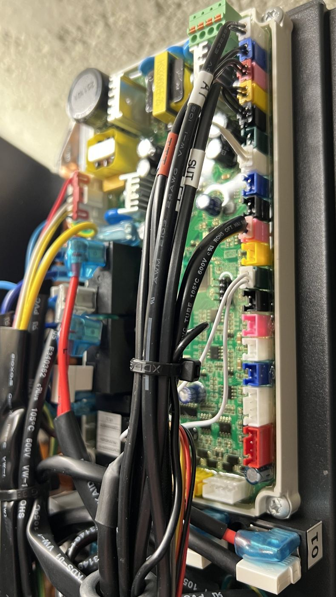
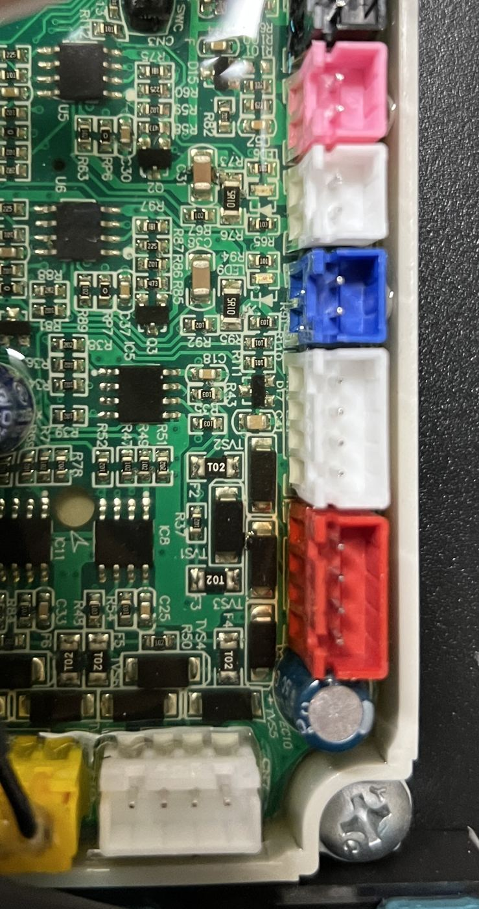
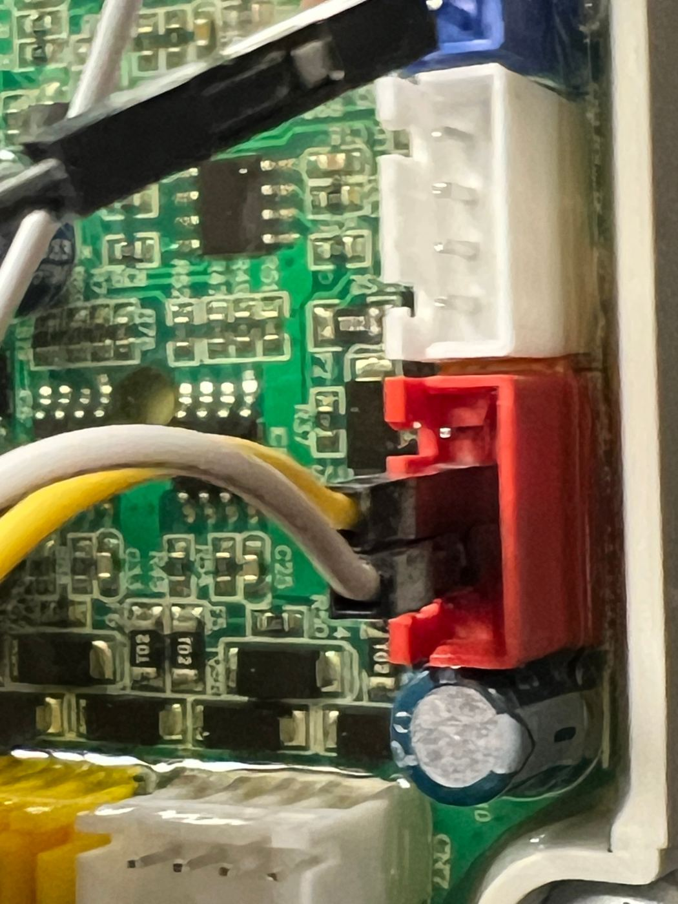
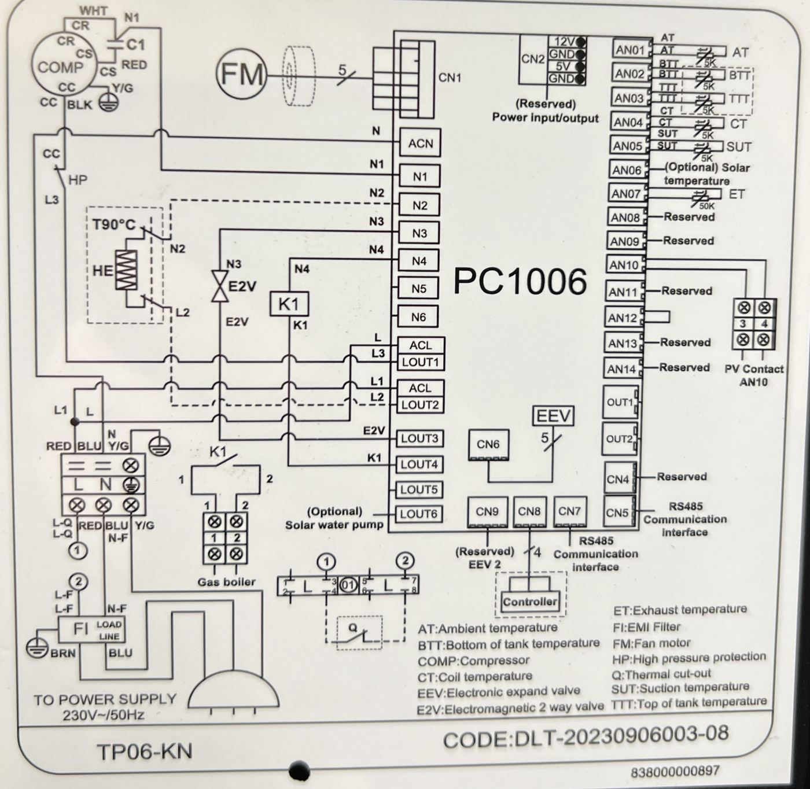

# Hardware

## Parts

**Path A – ESPHome**

| Part | Notes |
|---|---|
| Wemos D1 mini (ESP8266) | any ESP8266 board works; the YAML uses `board: d1_mini` |
| TTL-to-RS485 module with **MAX13487** (automatic direction) | 3.3 V logic, pins VCC / TX / RX / GND + A / B |
| 4 jumper wires (module ↔ D1 mini) and 2 wires to the TESY connector | |

**Archived path B – Node-RED** (first attempt, not developed further; instead of, not in addition to, path A)

| Part | Notes |
|---|---|
| Waveshare *RS485 to RJ45 Ethernet Industrial Serial Server Modbus Gateway* ([product page](https://www.waveshare.com/rs485-to-eth-b.htm?sku=23273)) | |
| Node-RED and an MQTT broker (e.g. Mosquitto add-on in Home Assistant) | |

**Optional:** a Shelly Plug S (or any smart plug with energy metering) to record the heat pump's electrical energy; used in the example dashboard.

## Where to connect

The PC1006 controller board has RS485 connectors **CN5** (red) and **CN7** (white); both are labelled *RS485 communication interface* on the unit's wiring label. I connected to **CN5**.

Pinout of **CN5**, top to bottom as in the photos:

| Pin | Signal |
|---|---|
| 1 | 12 V |
| 2 | B |
| 3 | A |
| 4 | GND |

Connect only **A** and **B** (and optionally GND) of your adapter in parallel to CN5 A/B. If no data arrives, swap A and B (standard RS485 troubleshooting).

*The controller board inside the unit; CN5 (red) and CN7 (white) at the bottom right.*

*Detail of CN5 (red) and CN7 (white).*

*Close-up of CN5 with the two signal wires inserted.*

*The wiring label inside the unit (TP06-KN, PC1006): CN5 and CN7 are marked "RS485 Communication interface".*

## ESP8266 ↔ RS485 module (auto-direction, MAX13487)

| Module pin | Connect to | Note |
|---|---|---|
| VCC | 3V3 | |
| GND | GND | |
| **TX** | **D7 (GPIO13)** | "TX" is the module's *output*, i.e. the bus data that goes into the ESP |
| RX | *leave open* | do not tie to 3V3/GND; a fixed level blocks reception on these modules |
| A / B | CN5 A / B | |

The module's RX LED should blink with each bus frame (about every 2.7 s); the TX LED stays dark.

Why D7 and not the default RX pin? The YAML swaps UART0 to GPIO13/15 so that the USB port stays free for flashing and does not disturb the bus; logs use UART1 (GPIO2) and WiFi.

Variant with a classic MAX3485/SP3485 module (separate DE/RE pins) – untested: RO → D7, DE and RE → GND, DI open, 3.3 V supply (a 5 V MAX485 would put 5 V on RO, which the ESP8266 does not tolerate).

## Power supply

The D1 mini is powered via **USB** (5 V supply). CN5 also has a 12 V pin; using it to power the ESP is not verified by this project.

## Safety

The unit contains mains voltage. Switch it off and unplug it before opening it. Only touch the low-voltage RS485 connector. Opening the unit may affect your warranty.
